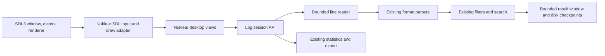
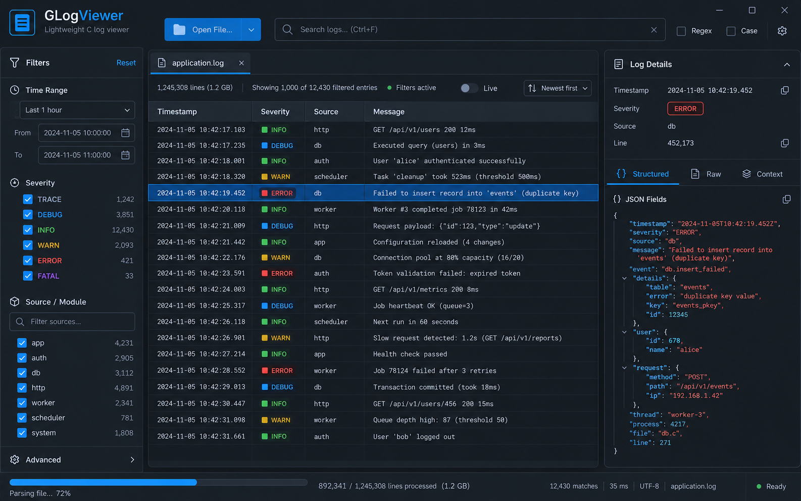
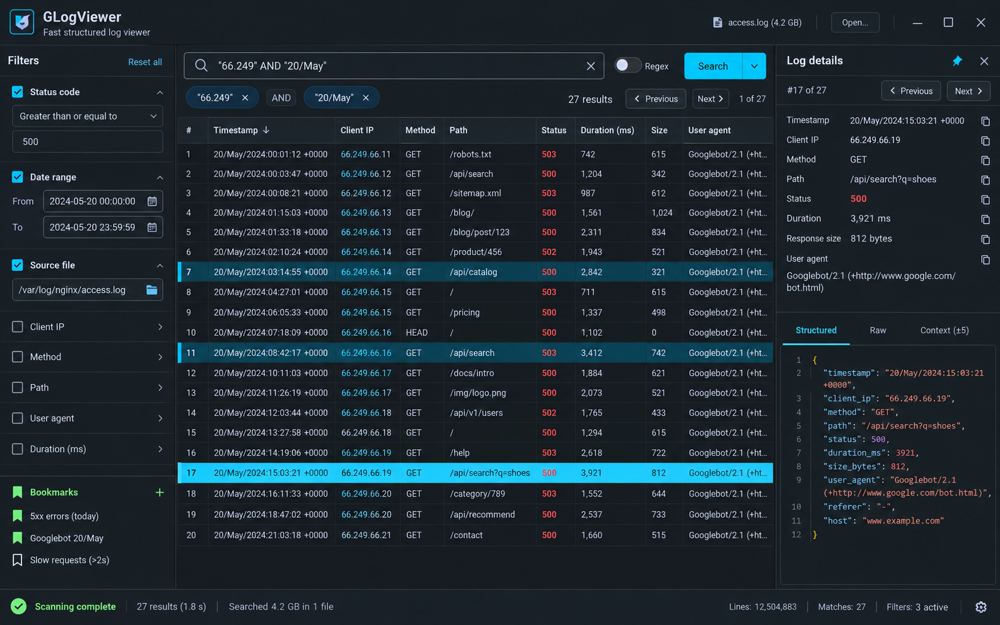
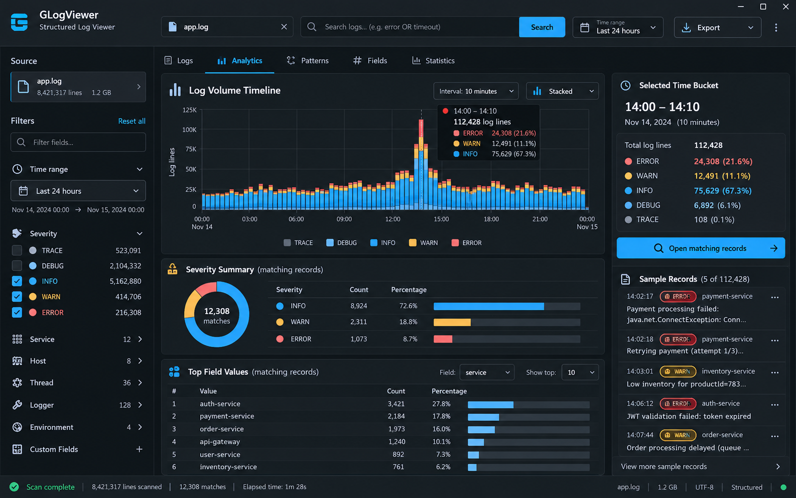

# GLogViewer Desktop GUI Implementation Plan

**Status:** The Windows GUI preview implements the TUI investigation workflows and is built with Nuklear 4.13.3 and SDL3 3.4.18. Its MSVC build, dummy-video live-scan capture, and Windows visual layout review pass. Linux/macOS GUI builds, interactive control checks, packaging, and automated GUI behavior coverage remain future release gates.

## 1. Goals

- Add a responsive desktop interface for opening, searching, filtering, inspecting, and exporting large log files.
- Preserve the current streaming reader, parser, regex engine, filters, statistics, and bounded-memory behavior.
- Keep the CLI and TUI buildable and usable without GUI dependencies.
- Implement application code in C. Nuklear is an ANSI C immediate-mode UI library; it supplies widgets and draw commands, but it does not create windows, handle operating-system input, or render those commands itself.
- Support Windows, macOS, and Linux with a documented, reproducible build for each.

## 2. Proposed technology choices

| Layer | Proposed choice | Reason |
| --- | --- | --- |
| Widgets and layout | Nuklear, vendored at a pinned commit or release | Small C library with controllable memory use and no required UI framework runtime. |
| Window, input, and 2D renderer | SDL3 | C API and official support for Windows, macOS, and Linux. SDL's 2D renderer avoids requiring GLogViewer to own a separate OpenGL renderer. |
| Text | Nuklear font atlas with a bundled, properly licensed font | Keep text rendering predictable and avoid adding SDL_ttf unless the prototype proves it is needed. |
| Existing log processing | Existing GLogViewer C modules | Avoid a second parser, filter implementation, or independent copy of scan behavior. |

SDL3 and Nuklear are GUI-only dependencies. The default `logview` CLI/TUI build must continue to build without either library. The GUI target may link SDL3 and ship its runtime where the platform requires it. The Nuklear repository documents that it emits draw commands and that platform/rendering backends are supplied by the application; therefore a small project-owned Nuklear-to-SDL3 adapter is part of the plan. Pin and record the exact upstream revisions and license notices before implementation.

The first prototype vendors Nuklear release `v4.13.3` at commit `a53ad2c658151071501372a5e0e5e978153835aa` and uses its SDL3 renderer adapter. The optional Windows build was compiled and startup-smoke-tested with SDL3 `3.4.18`; other platform builds have not yet been verified.

## 3. User experience scope

The current desktop implementation includes:

- Open one log file and show its path, format, scan progress, and errors.
- A virtualized record table with horizontal scrolling, column sizing, severity color, and a selected-row highlight.
- Search supporting Boolean queries, raw regex, field regex, exclusion regex, field filters, and custom parsing patterns.
- Quick severity filters for TRACE, DEBUG, INFO, NOTICE, WARN, ERROR, and OTHER; changing them starts a fresh bounded scan.
- Disk-indexed pages across the complete matching result set, source-line jump, bookmarks, and error/warning navigation.
- A details pane with structured fields, formatted JSON, exact raw source text, and configurable nearby context.
- Field-value summaries, a UTC time histogram, text/CSV export, and file follow.
- Cancel controls, byte progress, setup/scan/ready timers, and contextual help.

Remaining work focuses on cross-platform GUI verification, automated interaction coverage, packaging, multi-file workflows, saved GUI query profiles, configurable columns, and accessibility improvements.

## 4. Architecture

The GUI does not call `tui_run` and owns its SDL/Nuklear event loop. It shares the reader, parser, query, statistics, follow, JSON-formatting, and export modules with the CLI/TUI. GUI result and physical-context indexes are temporary disk files, with a bounded in-memory row page. The TUI still owns separate cache and checkpoint state in `src/tui.c`; extracting a shared UI-neutral session API remains a maintainability opportunity.

The UI must never retain borrowed `LogEntry` spans after the reader advances. The session API should return copied, size-limited display data or a short-lived view whose lifetime is explicit. Large record text should be fetched on demand for the selected row. The results table should request only visible rows plus a small prefetch window. Persistent data stays in the existing bounded cache/checkpoint approach, with temporary disk storage for indexes as needed.

Scanning should advance in bounded work slices from the desktop event loop in the first implementation. This keeps cancel, resize, and repaint responsive without introducing concurrency races. If measurements later justify background workers, workers must communicate through immutable result messages and must never call Nuklear or SDL rendering APIs.

## 5. Phases and gates

### Current desktop implementation

- Add optional `make gui` and `build.bat gui` targets; ordinary CLI/TUI builds remain independent of SDL3.
- Open one file through the native dialog or a command-line path, choose a supported format or auto-detection, and scan incrementally with a cancel control.
- Apply Boolean search, raw regex, field regex, exclusion regex, field filters, and custom patterns.
- Keep the window responsive with bounded scan, page-load, context, analysis, navigation, and export slices; show byte progress and setup/scan/ready timers.
- Keep a 16-byte-per-match temporary result index and sparse source-context checkpoints; load 64 matching records per page.
- Re-read a selected row from its source offset and display the complete record in 1 KiB pages, while showing parsed timestamp, level, and message fields when available.
- Provide source-line jump, bookmarks, severity navigation, nearby context, formatted JSON, field-value analysis, time histogram, and follow mode.
- Export the active query result set to text or CSV through a second incremental scan; export paths use UTF-8 on Windows.
- The GUI remains single-file. Persistent query profiles and configurable columns are not implemented.

**Current verification:** MSVC GUI build succeeds with SDL3 3.4.18, and the dummy-video scan smoke test stays active while processing a JSON Lines sample. The Windows CLI test suite passes across all 16 files in `SAMPLES`. GUI controls, analysis results, follow rotation, visual layout, and large-file memory still need interactive verification. macOS/Linux GUI builds and runtime behavior remain unverified.

The scan uses work slices of up to 80 ms, disables renderer VSync while scanning, and restores it when scanning ends. SDL events are handled between slices, and a lightweight progress view avoids redrawing the result table and detail pane during the scan. Result-index writes are batched. The theme uses higher-contrast colors, a branded toolbar, grouped sidebar sections, selected detail tabs, table headings, and byte progress. Source-line and level columns measure visible-page content while the message column uses the remaining width. Narrow windows stack results and details. Setup, scan, recent-record preparation, and total ready time are shown separately. The result navigation controls use two compact rows to keep pagination, bookmarks, and source-line jump visible at common window sizes. Advanced matching options are grouped under a collapsed sidebar section. A Windows screenshot review confirmed the three-pane proportions and Apache Error field presentation; interactive controls and other operating systems still need manual review.

### Phase 0: integration spike

**Status:** Completed for the Windows prototype. Cross-platform verification remains open.

- Pin Nuklear and SDL3 versions and add third-party notices.
- Build a small window on Windows, macOS, and Linux, feed mouse/keyboard/text input to Nuklear, and render basic text, rectangles, clipping, and scissoring through SDL3.
- Verify DPI scaling, resize, Unicode input, keyboard navigation, and clean shutdown.
- Add an optional GUI build target without changing the default CLI build.

**Gate:** all three platforms compile and launch the spike; the existing CLI/TUI test and sanitizer workflows remain unchanged and pass.

### Verification notes

- Build the GUI with `build.bat gui` on Windows; the script searches common local SDL3 extraction paths and accepts `SDL3_DIR` for custom locations. On macOS/Linux, use `make gui` where SDL3 development files and `pkg-config` are available.
- On Windows, the GUI was compiled with MSVC and SDL3 3.4.18 and launched with SDL's dummy video driver while scanning a JSON Lines sample.
- The Windows CLI regression suite passes with the GUI sources and optional dependency excluded from the normal build.
- macOS/Linux GUI builds, visual interaction, and large-file GUI performance have not been verified. The dummy-driver startup check confirms initialization and event-loop operation only; it does not replace manual GUI testing.
- The dummy-video check verifies process startup and scan-loop survival, not interactive controls, visual layout, or a completed large-file scan.

### Phase 1: UI-neutral log session

- Identify scan, selection, checkpoint, and export responsibilities embedded in `src/tui.c`.
- Extract reusable session operations into UI-neutral modules without changing CLI/TUI behavior.
- Add direct tests for bounded stepping, cancellation, navigation, query replacement, and borrowed-data lifetime.

**Gate:** existing test suite passes unchanged; session tests prove bounded memory and deterministic results on the small fixtures and large `SAMPLES` files.

### Phase 2: desktop log explorer

**Status:** Core explorer and result navigation are implemented and Windows-build verified. Cross-platform GUI verification and automated GUI interaction tests remain open.

- Add file-open flow, scan progress, virtualized table, severity styling, search, and next/previous navigation.
- Add a structured/raw/context details pane and on-demand full-record view.
- Add filter controls backed by existing query compilation and clear recoverable validation errors.
- Add export of the active result selection.

**Gate:** a user can open the project sample logs, search/filter, inspect an entire long record, cancel a scan, and export the selected rows on all supported platforms. Memory stays bounded independently of input file size.

### Phase 3: investigation and analysis views

**Status:** Bookmarks, context, severity navigation, field-value summaries, time histogram, and follow controls are implemented. Saved GUI query profiles, configurable columns, and deterministic automated GUI coverage remain open.

- Add bookmarks and saved query profiles using the current profile format.
- Add field-value summaries and a clearly labeled time histogram; clicking a bucket opens its matching records.
- Validate follow behavior for appended records, incomplete lines, truncation, and rotation on all supported platforms.
- Add column selection, sorting only where it can be supported without loading the full file, and user preferences.

**Gate:** every new action uses the same session selection semantics as CLI/TUI and has deterministic automated coverage.

### Phase 4: packaging and release

- Produce optional GUI packages for Windows, macOS, and Linux with required SDL3 runtime files and notices.
- Test clean-machine startup, file dialogs, Unicode paths, high-DPI displays, long paths, large files, and shutdown while scanning.
- Document `logview-gui` installation and distinguish it from the dependency-free CLI build.
- Run GUI smoke tests in CI where display infrastructure exists; retain manual platform checks for window-system-specific behavior.

**Gate:** clean platform builds, CLI/TUI suite, sanitizer run, GUI smoke tests, packaging checks, and a documented manual checklist pass before a GUI release is tagged.

## 6. Performance and reliability requirements

- The log engine remains streaming; no full-file record array or full-file text buffer.
- GUI rendering work scales with visible rows, not total matching rows.
- No parsing, regex evaluation, or file I/O runs synchronously during a frame without a bounded work budget.
- Search/filter edits cancel stale generations and do not replace the active result set when compilation fails.
- The GUI remains responsive to cancel, resize, and close while scanning.
- Report scan throughput separately from render responsiveness; benchmark cold and warm cache runs on the existing representative samples.
- Track peak resident memory for large samples. Do not claim the GUI has the same memory use as the CLI until measured.

## 7. Risks and decisions to validate

- **Renderer adapter:** Nuklear has no default renderer. The SDL3 adapter must correctly handle clipping, font textures, high-DPI scaling, and resource recreation after resize/device loss.
- **Desktop polish:** Nuklear is immediate-mode and customizable, but its controls are not native system widgets. Validate keyboard behavior, screen-reader limitations, and visual consistency before committing to the design.
- **Session extraction:** `src/tui.c` currently owns substantial indexing and interaction behavior. Extracting it without changing mature CLI/TUI semantics is the main engineering risk.
- **Dependency distribution:** optional GUI packages need platform-specific SDL3 packaging and license notices, while the source-level CLI remains dependency-free.
- **Search model:** sorting arbitrary columns and global multi-file filtering may require indexes or repeated scans. They must not silently violate bounded memory or latency expectations.

## 8. Acceptance criteria for the first GUI release

- GUI and CLI builds are separate; the CLI compiles without SDL3 or Nuklear installed.
- The GUI is implemented in C and shares parsers, filters, regex, export, and statistics with the existing product.
- A file larger than 1 GB can be scanned with bounded memory while progress and cancellation remain responsive.
- Search, filters, navigation, details, and export agree on which rows are selected.
- The user can read the full selected record regardless of terminal-style line width or table column width.
- Windows, macOS, and Linux builds and GUI smoke tests pass; packaging includes all required notices and runtime components.

## 9. Visual mockups

These images are design references, not pixel-perfect implementation requirements.

### Log explorer

### Search and investigation

### Analytics dashboard

## References

- [Nuklear official repository and integration notes](https://github.com/Immediate-Mode-UI/Nuklear)
- [SDL3 official overview](https://wiki.libsdl.org/SDL3/FrontPage)
- [GLFW official overview](https://www.glfw.org/)
