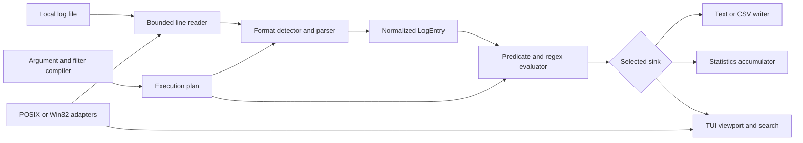
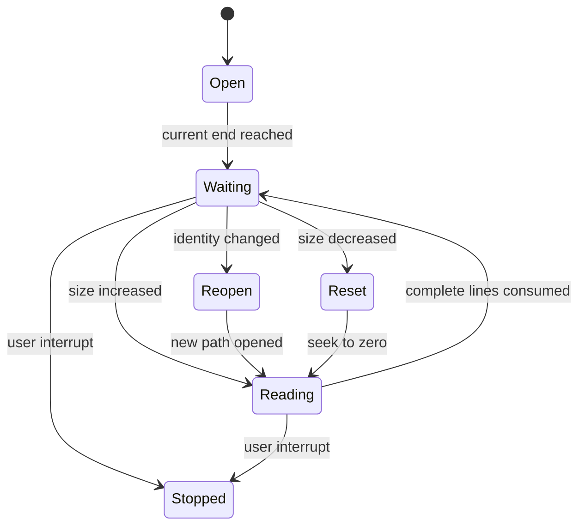

# Software Architecture

**Status:** architecture for stable versions 1.0 through 1.5.0. The project owner verified the test suite on Windows, Linux, and macOS. The behavioral contract is in [Technical Specification](TECHNICAL_SPECIFICATION.md), and validation evidence is in [Validation notes](VALIDATION.md).

## 1. Architectural goals

The architecture separates file access, format parsing, selection, aggregation, and presentation. The same streaming pipeline serves batch output, exports, statistics, and the TUI. Every module is written in C99. Platform-specific calls are confined to a small adapter layer, allowing core logic to be tested with in-memory fixtures.



## 2. Modules and ownership

| Module | Responsibilities | Interface boundary |
| --- | --- | --- |
| `cli` / query profiles | Parse arguments, validate combinations and versioned query settings, choose mode and exit status | CLI arguments override the loaded profile; multi-file batch runs enter the bounded k-way merge path. |
| `line_reader` | Reusable bounded buffer, LF/CRLF handling, 64-bit offsets, final partial line, seek/reposition for follow | Emits transient `LineView`. |
| `follow` | Poll file size and identity; wait for complete lines; reopen rotations and reset truncated inputs | Repositions the reader and preserves the last complete line number. |
| `format_detect` | Bounded sample and confidence scoring | Chooses a preset or raw mode. |
| `parser_syslog` | Distinct RFC 3164-like and RFC 5424 parsers | Fills normalized fields without changing raw data. |
| `parser_cri` | Kubernetes CRI timestamp, stream, tag, and message parser | Preserves physical rows and exposes fragment tags without joining them. |
| `parser_http` | Apache Common/Combined and NGINX Combined parsers | Fills access-specific fields. |
| `parser_jsonl` | Bounded JSON objects, nested objects/arrays, and object arrays | Decodes strings into reusable scratch memory; exposes nested fields as dotted paths and leaf aliases. |
| `parser_custom` | Compile and run placeholder patterns | Produces canonical aliases and named fields. |
| `regex_compile` | Lex and parse supported regex into AST; reject invalid syntax | Emits immutable NFA program and capture metadata. |
| `regex_vm` | Iterative NFA matching and match spans | Reads byte slices; enforces state and work limits. |
| `filter` | Compile expression grammar and evaluate predicates | Reads `LogEntry`, never mutates it. |
| `stats` | Exact physical/parsed/rejected/selected and per-level counts; timestamp normalization | Fixed-bin timeline and bounded Space-Saving estimates; optional year/fixed-offset context interprets RFC 3164 date fields without altering record data. |
| `export` | Stream raw text or CSV with escaping, UTF-8 replacement, source-file labels, and short-write handling | Consumes selected entries immediately; multi-file CSV always includes `source_file`; protects existing files by default. |
| `multi_input` | Hold one current selected timestamped record per source, enforce source timestamp monotonicity, merge by epoch and stage unknown-time records | Heap use is bounded by 16 readers and their current records; temporary files hold unknown-time rows and stats epochs. |
| `follow` | Poll, detect append/truncation/replacement, wait for complete records, and maintain reader state | Repositions the shared reader for the pipeline. |
| `tui` | Input, bounded viewport, search, severity jumps, source-line bookmarks, configurable context, live follow, resize handling, dynamic filter edits, field summaries, histogram, help, clipped rendering | Retains 256 rows with 1 KiB previews; stores up to 32 session bookmarks in memory and navigation/context checkpoints in temporary files. Shares timestamp interpretation settings with batch statistics. |
| `platform` | 64-bit seek/stat, sleep, file identity, terminal mode and input | POSIX and Win32 implementations with a common header. |

Proposed layout:

```text
include/logview/*.h
src/core/*.c
src/parsers/*.c
src/regex/*.c
src/ui/*.c
src/platform/posix/*.c
src/platform/windows/*.c
tests/unit/*.c
tests/integration/*
bench/*
Makefile
build.bat
```

The current implementation uses `include/logview.h`, `src/main.c`, `src/reader.c`, `src/reader.h`, `src/follow.c`, `src/follow.h`, `src/terminal.c`, `src/terminal.h`, `src/tui.c`, `src/tui.h`, `src/jsonl.c`, `src/jsonl.h`, `src/json_pretty.c`, `src/json_pretty.h`, `src/parsers.c`, `src/parsers.h`, `src/filter.c`, `src/filter.h`, `src/output.c`, `src/output.h`, `src/stats.c`, `src/stats.h`, `src/regex.c`, `src/regex.h`, and `tests/test_cli.py`.

## 3. Data contracts and lifetime

```c
typedef struct {
    const unsigned char *data;
    size_t length;
} ByteSpan;

typedef struct {
    ByteSpan raw;
    uint64_t line_number;
    uint64_t byte_offset;
    ParseStatus status;
    FieldView fields[LOGVIEW_MAX_FIELDS];
    size_t field_count;
} LogEntry;
```

`ByteSpan` is length-delimited to avoid accidental reliance on NUL termination. `FieldView` stores canonical field ID or a name span, a value span, and presence flag. The `LogEntry` and its field spans are borrowed views into the line buffer or JSON scratch arena. Their lifetime ends at the next reader step. A sink that needs data afterward must copy it into a bounded cache. Counters and offsets use 64-bit unsigned values with checked increment; `size_t` governs in-memory lengths. The parser result includes a reject reason for diagnostics and statistics.

The execution plan owns compiled regex programs and custom pattern instructions for the duration of the run. TUI filter edits compile into a temporary plan, then atomically replace the active selection only if compilation succeeds; invalid edits leave the previous filter active.

## 4. Streaming sequence

1. Parse and validate command-line options and compile the filter, regex, and custom pattern.
2. Open the input file and, if requested, sample a bounded prefix to detect its format. Return to the chosen starting offset.
3. Read one complete physical line into the reusable buffer. Overlong lines are drained without allocation beyond the configured cap.
4. Parse the line into a transient `LogEntry`, preserving raw text on parse failure.
5. Evaluate field predicates and regex clauses with short-circuiting where it preserves semantics.
6. Send selected entries to exactly one primary sink: batch text, export, stats, or TUI. Global parsed/rejected counters update regardless of selection.
7. Release the transient entry implicitly when reading the next line.

The statistics sink accumulates exact record and level counters plus a 512-entry Space-Saving table in fixed memory. Timeline output uses the first pass to determine the time range and a second streaming pass to fill 256 bins. The second pass reapplies the same parser and selection plan; timestamps outside the first-pass range signal a changed input or inconsistent parse.

## 5. Regex architecture

The regex parser uses recursive descent only while compiling a bounded pattern. Its AST represents literal, dot, class, anchors, concatenation, alternation, repeat, and group nodes. A pattern length and AST depth limit prevent compile-time stack overflow. Thompson construction turns the AST into a compact program of character/class tests, splits, jumps, capture tags, assertions, and match. The VM uses two state lists with generation counters to deduplicate active states. Capture tags track the chosen leftmost match without recursively exploring paths. Exact capture-priority semantics must be covered by tests before release.

This design follows the algorithmic distinction explained by [Russ Cox](https://swtch.com/~rsc/regexp/regexp1.html): the language subset is regular, so recursive backtracking is unnecessary and can be pathological. Pattern placeholders use a separate deterministic extractor and never depend on a regex feature that the user engine does not implement.

## 6. TUI and large-file navigation

The TUI keeps a fixed-size viewport cache and a fixed-size ring of nearby selected rows. A temporary file stores one checkpoint per 128 selected rows; each checkpoint maps the selected-row sequence to a source line number and byte offset. To display a region outside the cache, the TUI seeks to the preceding checkpoint, reapplies the active selectors, and reads forward until the requested rows are cached. This keeps heap use fixed while allowing navigation with latency bounded by the number of selected rows between checkpoints. The status line distinguishes “scan in progress” from a complete result count.

Search and filter edits increment a generation ID. Scan slices check it and cancel stale work. Rendering operates only on the visible rows. Log text is sanitized for display by replacing control bytes and clipping to terminal width, then match spans are styled with ANSI attributes. A resize recomputes the viewport but does not reparse the whole file. The TUI event loop interleaves nonblocking input, scan slices, follow polling, and screen refresh; no background threads are required in v1.

## 7. Follow state machine



The follow controller stores file identity, current offset, partial-line bytes, and last observed size. It emits a status event on truncation or replacement so a TUI can inform the user. When a replacement cannot be opened, the controller retries while preserving a diagnostic status. Exact zero-loss continuity across rename races is outside the first release; the documented behavior is deterministic for the file currently held and the new path once observed.

## 8. Platform boundary

The core sees `platform_file_open`, `platform_file_seek64`, `platform_file_identity`, `platform_sleep_ms`, and `platform_terminal_*` functions. POSIX implementations can use `fseeko`, `stat`, and `termios`; Windows implementations can use `_fseeki64`, file information APIs, and console mode/input APIs. Build checks must verify large-file support. ANSI color is enabled only for capable terminals. Raw mode is restored through one cleanup path after normal exit or recoverable error.

## 9. Build and verification stages

| Release | Architectural slice | Gate |
| --- | --- | --- |
| 0.1 MVP | Reader, raw/JSON Lines parser, regex compiler/VM, simple equality filter, CLI text sink | Implemented; Windows, Linux, and macOS suites are reported passing; the Windows 1 GiB benchmark and RSS target pass. |
| 0.2 implemented | Syslog/HTTP/custom parsers, detection, filter-expression compiler | Core CLI checks pass on Windows and Linux; broader golden fixtures remain part of release hardening. |
| 0.3 implemented | CSV/text export, exact record/level statistics, timeline, bounded estimates | Windows tests pass; large sample tests also pass on Linux. |
| 0.4 implemented | Batch follow controller | Windows and Linux append/partial/truncate/from-start/rotation/Ctrl-C tests pass. |
| 0.5 complete | TUI with bounded viewport, full-scan navigation, search, filters, context, and follow | Windows build and non-terminal checks pass; expanded Linux PTY scenario passes; user-reported manual checks cover Windows Terminal and macOS. A repeatable terminal matrix remains in release validation. |
| 0.9–1.0 | Hardening, benchmark, documentation, release packaging | Published evidence for every 1.0 gate. |
| 1.1 published | Lexical range filters, result windows, complete-record CLI inspection | Tagged release v1.1.0. |
| 1.2 development complete | JSON pretty presentation, focused frequent-value statistics, navigable TUI histogram | Windows build and full local suite pass; Linux/macOS PTY, Linux sanitizers, and release packaging remain. |

The release history and future milestones are in the [product roadmap](ROADMAP.md); implementation sequence and acceptance criteria for upcoming releases are in the [implementation plan](IMPLEMENTATION_PLAN.md).

The [Loghub corpus](https://github.com/logpai/loghub) can provide additional real-world parser fixtures after reviewing dataset licenses and privacy. The [Drain paper](https://pinjiahe.github.io/files/pdf/research/ICWS17.pdf) concerns automatic log-template discovery; this architecture intentionally uses explicit parsers and custom patterns first.
